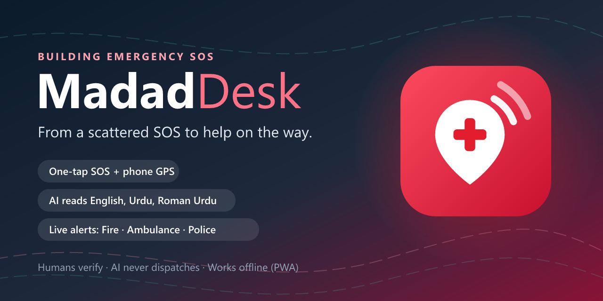

# MadadDesk



From scattered distress messages to a verified emergency picture.
AI-assisted SOS intake (English / Urdu / Roman Urdu), coordinator verification and simulated
multi-agency response for building emergencies.

> Prototype for drills and demos only — not a deployed emergency service.

**Live demo:** https://mdaddeskv1-6af42.web.app (staff demo logins are shared privately with judges/testers).

**New here?** Start with [docs/how-to-start.md](docs/how-to-start.md) (setup, accounts, demo script).
AI agents: see [AGENTS.md](AGENTS.md).

## Quick start (local)
```bash
npm install
cp web/.env.example web/.env     # Firebase web config (see docs/firebase-setup.md)
npm run dev                      # web on http://localhost:5173
```
Gemini runs through **Firebase AI Logic** (free Spark plan), so no server is needed.
`api/` is only for the accuracy eval: put `GEMINI_API_KEY` in `api/.env`, then `npm run eval`.

## Firebase setup (free, no card)
Follow **[docs/firebase-setup.md](docs/firebase-setup.md)** step by step.

## Deploy
```bash
npm run build -w web && firebase deploy --only hosting,firestore:rules
```
Test links for teammates, rollback and checks: **[docs/deployment.md](docs/deployment.md)**.

## Scripts
| Command | What |
|---|---|
| `npm run dev` | web app with reload |
| `npm run typecheck` | both workspaces |
| `npm run eval` | extraction accuracy on `data/synthetic-reports.json` |
| `npm run seed -w api` | demo accounts + agencies |
| `npm run check-firebase-ai -w api` | does Gemini answer through Firebase? |

## Docs
- [docs/prd.md](docs/prd.md) — scope, users, trust rules, demo script
- [docs/core-structure.md](docs/core-structure.md) — folders, data model, code rules
- [docs/progress.md](docs/progress.md) — daily log
- [docs/bug-fix.md](docs/bug-fix.md) — bugs and fixes
- [docs/firebase-setup.md](docs/firebase-setup.md) — create the Firebase project (done for `mdaddeskv1-6af42`)
- [docs/deployment.md](docs/deployment.md) — put it online, test links for teammates
- [docs/testing-e2e.md](docs/testing-e2e.md) — step-by-step test checklist for the team
- [docs/testing-user.md](docs/testing-user.md) — testing with real people

## Stack
React + TypeScript + Vite + Tailwind (PWA) · Firebase Hosting · Firestore · Firebase Auth · Gemini via Firebase AI Logic · Leaflet + OpenStreetMap

## License
[MIT](LICENSE) © 2026 Maryam Saba

<!-- taggie -->
Crafted with ❤ by Maryam Saba for safer buildings
<!-- /taggie -->
